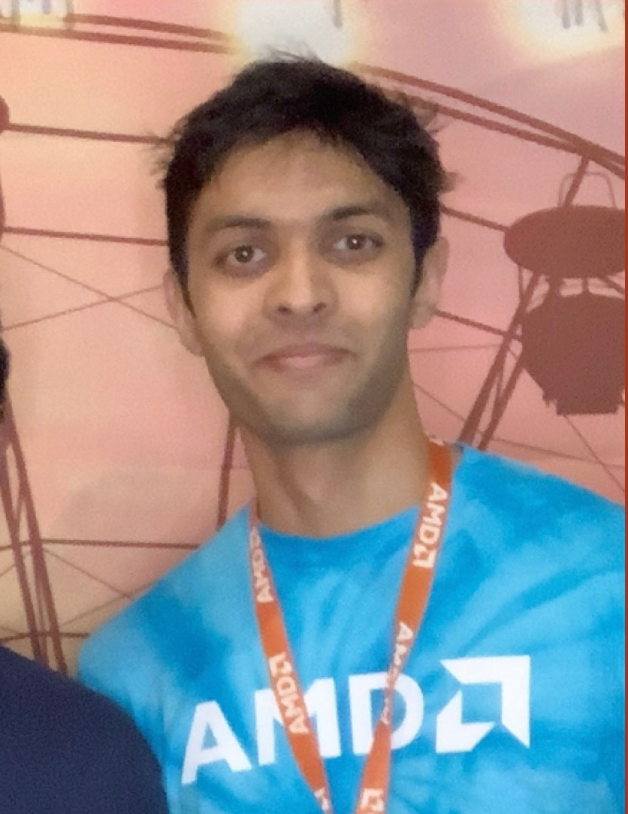

# Hi, I'm Hemil!

I'm a senior studying **Electrical and Computer Engineering** at the University of Washington. I'm originally from India and I graduate in June 2027.

Want to know more about me outside of school? Check out my [About page](about.html).

## My Academic Interests

These are the areas I like the most:

- Computer architecture
- Digital design
- Low-level software
- Consumer tech

I'm pretty decent at **SystemVerilog**. It's a *hardware description language*, which means you use it to design chips instead of writing regular software programs.

## Experience

| Where | Role | What I did |
|-------|------|------------|
| AMD (Austin, TX) | SoC Power Architecture Intern | Worked on power architecture in the Client Business Unit |
| Tactical Affairs | Electrical Engineering Intern | Help built the company's targeting system from the ground up |
| University of Washington | Teaching Assistant | Currently TAing for EE/CSE 371 (Digital Design) |

## My Projects

My GitHub hosts all the technical projects I've worked on. Have a look :)

[github.com/hemzp](https://github.com/hemzp)
